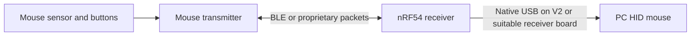

# Development and USB-HS investigation

Research date: October 20, 2026. Physical board revision and silicon revision remain unconfirmed. All commands below are proposed bring-up steps; no compiler, flash, radio, or USB performance test has been run in this research pass.

Follow-up: the SDK was subsequently installed, registration repaired, and a reference DK Hello World build verified. See [SDK registration repair](SDK_REGISTRATION.md). XIAO-specific builds, flashing, and hardware performance remain unverified.

Latest status: the user confirmed **board V1.0**. The [first project](../apps/blinky/README.md) now builds successfully with NCS v3.4.1 and the pinned Seeed board root. This resolves the initial board-build compatibility uncertainty below for that LED application. Silicon revision and all hardware execution remain unverified; OpenOCD is still needed for programming. The original investigation is retained below as historical research.

## Establish the hardware revision first

1. Record the order SKU, packaging, board markings, and whether it is the Sense variant.
2. Connect a known data-capable USB cable. On Linux, run `lsusb`, `lsusb -t`, and inspect the new device's manufacturer/product strings with `lsusb -v -d VID:PID` using its actual ID.
3. A SAMD11/CMSIS-DAP debug probe is evidence for V1.0. Native CDC/MCUmgr loader behavior is evidence for V2.0. Firmware can change descriptors; corroborate this with the physical board or Seeed's order information. A missing USB device is not proof of either revision.

The local USB inventory did not show an identifiable XIAO. An ST-LINK/V2 was present, but nRF54LM20A programming support through that probe was not established.

The published V1.0 schematic's sheets 4 and 5 route USB-C to SAMD11. Sheet 6 marks Nordic D- K4 and D+ K5 unconnected and VBUS resistor R23 unpopulated. The editable PCB also labels K4/K5 unconnected. There is no native USB breakout in that design, so firmware configuration cannot enable it through the connector. Rework would require access beneath the CSP and proper USB routing; a native USB receiver board is the practical alternative. [Seeed schematic](vendor/seeed/XIAO_nRF54LM20A_Schematic.pdf)

Seeed's pinned [V2.0 overlay](vendor/seeed/platform-seeedboards-a6fd41d/zephyr/nrf/boards/seeed/xiao_nrf54lm20a/xiao_nrf54lm20a_nrf54lm20a_cpuapp_2_0_0.overlay) states that V2.0 removes SAMD11 and uses Nordic native USB, with MCUboot and a USB loader. Its flash and pad arrangements also differ. That source establishes intended support; it does not establish this unit's revision or measured USB speed.

## Toolchain choice

Use C/C++, nRF Connect SDK (NCS), Zephyr, and nRF Connect for VS Code for the main project. This gives access to Nordic radio libraries, device drivers, USB classes, debugger support, and reusable CMake/west builds.

| Route | Evidence and use |
| --- | --- |
| NCS v3.3.0 plus matching toolchain | Version in [Seeed's walkthrough](https://wiki.seeedstudio.com/xiao_nrf54lm20a_ncs/); useful as the vendor's documented baseline, not validation of every newer board revision |
| NCS v3.4.1 plus matching toolchain | Current stable/LTS; [Nordic silicon compatibility](https://docs.nordicsemi.com/r/bundle/comp_matrix_nrf54lm20a/page/comp/nrf54lm20a/nrf54lm20a_nrf_connect_sdk.html) lists supported Engineering B/Revision 1 combinations; preferred broader project target once Seeed integration builds |
| Seeed PlatformIO/Zephyr | Convenient board-specific upload tooling; useful for an initial vendor example |
| MicroPython / community Arduino | Alternatives for experiments; keep the first radio/USB performance work on NCS |

NCS v3.4.1's [manifest](https://github.com/nrfconnect/sdk-nrf/blob/v3.4.1/west.yml) pins Zephyr to `ncs-v3.4.1`. That release's [Seeed board directory](https://github.com/nrfconnect/sdk-zephyr/tree/ncs-v3.4.1/boards/seeed) lacks this XIAO LM20A board; current development documentation includes it. Add the **full** Seeed repository's `zephyr/nrf` as a board root. The local source snapshot here contains selected evidence files and is not a complete buildable board package. Pin the full package to commit `a6fd41debbbcda13b5340fff50c9092ed3289194` for reproducibility. Its compatibility with NCS v3.4.1 still needs a build test.

Install the Nordic VS Code extension and nRF Util using the official installers, then use the [SDK installation procedure](https://nrfconnectdocs.nordicsemi.com/ncs/latest/nrf/installation/install_ncs.html):

```bash
nrfutil install sdk-manager
nrfutil sdk-manager search
nrfutil sdk-manager install v3.4.1
nrfutil sdk-manager toolchain launch --ncs-version v3.4.1 --shell
```

In VS Code, set **nRF Connect: Board Roots** to the full checkout's `zephyr/nrf` directory. Use the installed SDK's toolchain terminal so Python, west, compiler and CMake versions agree.

Revision-specific targets from [Seeed's board declaration](vendor/seeed/platform-seeedboards-a6fd41d/zephyr/nrf/boards/seeed/xiao_nrf54lm20a/board.yml):

```text
V1.0: xiao_nrf54lm20a@1.0.0/nrf54lm20a/cpuapp
V2.0: xiao_nrf54lm20a@2.0.0/nrf54lm20a/cpuapp
```

An unqualified target defaults to V1.0. Select the revision explicitly. From the SDK workspace, an illustrative V1 build is:

```bash
west build -p always -d build/blinky \
  -b xiao_nrf54lm20a@1.0.0/nrf54lm20a/cpuapp \
  zephyr/samples/basic/blinky \
  -- -DBOARD_ROOT=/absolute/path/to/platform-seeedboards/zephyr/nrf
```

For V1, Seeed's runner uses CMSIS-DAP/OpenOCD and its `nrf54lm20a-load` operation. Use the Seeed-provided OpenOCD build/configuration; upstream generic support cannot be assumed. The expected runner invocation is `west flash --build-dir build/blinky --runner openocd`. The pinned configuration includes an RRAM write-buffer commit fix. Seeed's [NCS guide](https://wiki.seeedstudio.com/xiao_nrf54lm20a_ncs/) explains installing its OpenOCD package.

For V2, first establish the matching signed-image and USB-loader upload workflow. Preserve its factory MCUboot/loader partitions. Do not flash a V1 image or erase/recover the device as an identification step. A native USB serial port is an application/loader interface, not an onboard SWD debugger; SWD debugging needs a compatible external probe.

## Wireless mouse experiments

Two useful architectures are:



For standard Bluetooth mouse operation, the PC can instead be the BLE host and no custom USB receiver is required. For a dedicated receiver, both radio endpoints must implement a compatible protocol. Receiving an existing commercial mouse's encrypted/proprietary traffic is a separate interoperability problem.

| Experiment | Starting point | What it proves |
| --- | --- | --- |
| Advertising and GATT | [Seeed BLE examples](https://wiki.seeedstudio.com/xiao_nrf54lm20a_with_bluetooth_lowpower/) and nRF Connect for Mobile | Basic board, antenna, radio and host operation |
| Standard Bluetooth mouse | [Peripheral HIDS mouse](https://github.com/nrfconnect/sdk-nrf/tree/v3.4.1/samples/bluetooth/peripheral_hids_mouse) | HID reports over BLE; requires XIAO configuration |
| Proprietary transceiver | [ESB PTX](https://github.com/nrfconnect/sdk-nrf/tree/v3.4.1/samples/esb/esb_ptx) and [PRX](https://github.com/nrfconnect/sdk-nrf/tree/v3.4.1/samples/esb/esb_prx) | Packet acknowledgments, retransmissions and bidirectional payloads |
| Integrated design | [nRF Desktop](https://github.com/nrfconnect/sdk-nrf/blob/v3.4.1/applications/nrf_desktop/board_configuration.rst), then matching [HID Add-on](https://nrfconnectdocs.nordicsemi.com/addons/addon-hid/latest/setup.html) | Reference HID architecture and newer dongle configurations |

ESB is a useful starting recommendation for a mouse and dedicated receiver under your control. BLE is useful for host compatibility. Nordic's [LLPM](https://nrfconnectdocs.nordicsemi.com/ncs/latest/nrf/samples/bluetooth/llpm/README.html) is another low-latency option requiring a compatible Nordic peer. A radio's advertised bitrate does not establish its achievable report rate.

Attach the correct antenna before RF tests. Start with incrementing packet sequence numbers, timestamps, button bits and synthetic motion. Measure packet loss, retry count, jitter and latency before adding a sensor. Use two radio endpoints for a custom link; one board plus a BLE phone/PC is enough for initial BLE validation. Add pairing/encryption and interference/channel handling before treating a raw packet demo as a finished mouse protocol.

## Implement native USB-HS HID

The [datasheet](vendor/nordic/nRF54LM20A_nRF54LM20B_Datasheet_v1.0.pdf), section 8.27, page 790, specifies 480 Mb/s USB device mode. D+/D- are dedicated pins, not remappable GPIO. Native hardware needs VDD, valid VBUS, the USB supply/decoupling, and the specified 200-ohm 1% tuning resistor and controlled-impedance routing. The peripheral is appropriate for a PC-facing USB device.

Use this sequence on a confirmed V2 or a suitable DK:

1. Prove native CDC enumeration first and record negotiated USB speed.
2. Port NCS's [Zephyr HID mouse sample](https://github.com/nrfconnect/sdk-zephyr/tree/ncs-v3.4.1/samples/subsys/usb/hid-mouse). Its configuration enables `CONFIG_USB_DEVICE_STACK_NEXT=y` and `CONFIG_USBD_HID_SUPPORT=y`; its code registers a report descriptor, initializes USB explicitly and submits reports. Default polling is 1,000 microseconds.
3. On XIAO V2, preserve its factory image layout. Move diagnostics to UART/RTT for a HID-only device, or deliberately configure composite CDC+HID, since the board defaults expect a CDC console.
4. Verify `CONFIG_USBD_MAX_SPEED_HIGH=y` in the generated `.config` and **480M** for the actual device in `lsusb -t`. A USB version descriptor or a 480M hub alone is insufficient.
5. Extend the descriptor and matching report structure for buttons, signed relative motion, wheel, and optional vendor-defined feature reports. Keep a standard mouse interface for normal OS input; a second vendor HID interface can carry configuration. Boot protocol support, if needed, requires its prescribed boot reports as well as custom report handling.
6. After the 1 kHz test works, request `in-polling-period-us = <125>` in the HID node and measure useful reports. The [stable nRF Desktop LM20A overlay](https://github.com/nrfconnect/sdk-nrf/blob/v3.4.1/applications/nrf_desktop/configuration/nrf54lm20dk_nrf54lm20a_cpuapp/app.overlay) provides this 8 kHz scheduling example.

For a reference DK, the source-supported, **unbuilt here** command from an NCS workspace is:

```bash
west build -p always -d build/usb-mouse \
  -b nrf54lm20dk/nrf54lm20a/cpuapp \
  zephyr/samples/subsys/usb/hid-mouse
```

This is not a XIAO firmware image. The DK's [USB board definition](https://github.com/nrfconnect/sdk-zephyr/blob/ncs-v3.4.1/boards/nordic/nrf54lm20dk/nrf54lm20_a_b_cpuapp_common.dtsi) enables `vregusb` and `usbhs` and is a reference for the port.

USB High Speed permits 125-microsecond interrupt scheduling; that does not guarantee 8,000 fresh radio-derived reports each second. Keep radio receive callbacks short, queue reports to the USB task, and measure queue depth, dropped packets, USB submission completion and end-to-end latency. Mouse data volume is small; timing and consistency matter more than the 480 Mb/s bus bitrate.

## Completion criteria for the implementation stage

The developer toolchain is functional when a pinned SDK/board combination builds, programs, logs and debugs a repeatable example. The wireless test is functional when two endpoints exchange measured, acknowledged packets. The receiver is functional when the PC enumerates its intended HID interfaces at the measured bus speed and receives correct motion/button reports under radio traffic. None of these hardware outcomes is claimed by this research report.
