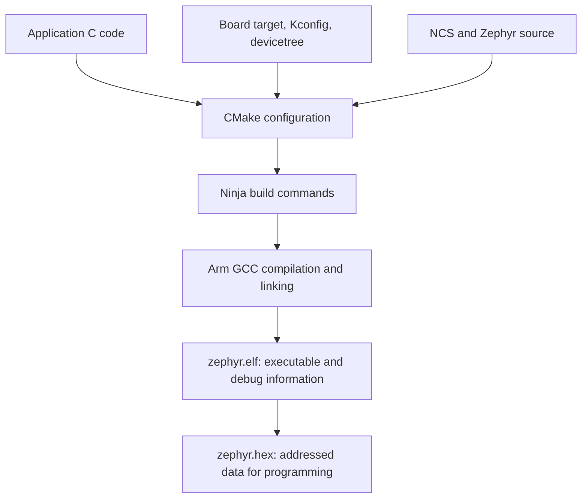
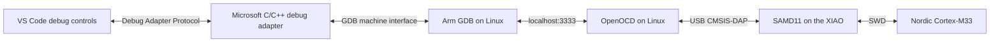

# Your XIAO toolchain and its VS Code integration

This describes the working setup for your **XIAO nRF54LM20A V1.0**, as verified on
October 21, 2026. It assumes you understand that VS Code tasks execute commands
and that JSON files configure those tasks.

VS Code gives you buttons, terminals, source navigation, and debugger controls.
The programs behind those controls build firmware on your Linux PC, transfer it
to the Nordic chip, and control the chip while it executes. Your C application
runs on the board's Cortex-M33 application core.

**The SDK provides the firmware ingredients. The toolchain provides the programs
that turn those ingredients into an executable.**

| Component | Its job in this project |
| --- | --- |
| nRF Connect SDK (NCS) v3.4.1 | Supplies Zephyr, Nordic libraries, drivers, samples, and their versioned dependencies |
| Zephyr | Provides the operating-system kernel, device APIs, and build/configuration framework compiled into your firmware |
| Seeed board definitions | Describe this board's wiring, clocks, LEDs, and programming interface |
| Nordic toolchain bundle `8285d8ad56` | Supplies compatible host tools, including the Arm compiler, linker, GDB, CMake, Ninja, and Python environment |
| SDK manager | Starts commands inside that toolchain's environment |
| `west` | Coordinates Zephyr operations such as building and flashing |
| CMake and Ninja | Configure the build, then execute the required compilation and linking commands |
| Arm GCC and linker | Translate C into Arm machine code and combine the application, kernel, drivers, and libraries into firmware |
| Arm GDB | Uses debug information to connect source lines and variable names to the running machine code |
| Seeed's OpenOCD | Communicates with the board's CMSIS-DAP debug probe for programming and CPU control |

Zephyr is compiled and linked together with your application. You do not first
install a separate Zephyr OS onto the chip and then install your application on
top. The resulting firmware includes the selected kernel, drivers, libraries,
and your code.

The SDK source lives at `/home/skipper/ncs/v3.4.1`. The host toolchain lives at
`/home/skipper/ncs/toolchains/8285d8ad56`. Keeping them separate lets the tooling
select a compatible set without relying on whichever compiler or Python happens
to be first in your ordinary shell's `PATH`. The bundle identifier is an
installation ID; it is not a compiler version number.

Your tasks invoke the SDK manager executable bundled with the Nordic VS Code
extension. Its `toolchain launch` operation starts `west` with the appropriate
environment. Here, “launch” means launching a host process with the right tools
available. Programming and executing the firmware happen later.

## From source code to firmware

The build follows this path:



`west build` is the command at the front of this process. It arranges the CMake
configuration and invokes the build tool. CMake determines what must be built;
Ninja executes those commands. An incremental build can reuse unchanged outputs.
Changes to configuration can cause CMake to run again. This two-stage arrangement
is documented in [Zephyr's build-system guide](https://docs.zephyrproject.org/latest/build/cmake/index.html).

The compiler is a **cross-compiler**: it runs on your Linux PC but produces code
for the Arm chip. A normal desktop `gcc main.c` command would neither select this
hardware nor assemble the required Zephyr application.

Your selected board target is:

```text
xiao_nrf54lm20a@1.0.0/nrf54lm20a/cpuapp
```

It chooses the XIAO board, its V1.0 hardware revision, the Nordic SoC, and the
Cortex-M33 application core. Targeting the chip alone would omit the board's
particular wiring. The Seeed definitions are supplied as an external **board
root** because the installed SDK does not include this board's definitions.
Their pinned version is recorded in
[the dependency guide](/home/skipper/repos/seeed_studio_nRF54LM20A/third_party/README.md).

The application files divide responsibility like this:

| File | What it controls |
| --- | --- |
| [CMakeLists.txt](/home/skipper/repos/seeed_studio_nRF54LM20A/apps/blinky/CMakeLists.txt) | Locates Zephyr, adds the Seeed board root, and lists application source files |
| [prj.conf](/home/skipper/repos/seeed_studio_nRF54LM20A/apps/blinky/prj.conf) | Selects software features using Kconfig, including GPIO and the UART console |
| [app.overlay](/home/skipper/repos/seeed_studio_nRF54LM20A/apps/blinky/app.overlay) | Adjusts the hardware description: frees the LED pins from PWM and disables V1.0's unwired native USB |
| [debug.conf](/home/skipper/repos/seeed_studio_nRF54LM20A/apps/blinky/debug.conf) | Adds debug-friendly optimization and Zephyr thread metadata for the debug build |
| [main.c](/home/skipper/repos/seeed_studio_nRF54LM20A/apps/blinky/src/main.c) | Implements the LED's behavior |

For example, changing the blink interval is a C-code change. Enabling a software
subsystem usually involves Kconfig. Assigning or enabling a particular hardware
peripheral involves devicetree. Adding another C file normally means adding it
to `target_sources(app ...)` in CMake.

Generated configuration and build files belong in the build directories. Edit
the application inputs above; rebuilding regenerates the corresponding outputs.
The small cache cleanup in this application's CMake file handles the NCS 3.4.1
crypto-string issue we encountered. It is a compatibility workaround rather
than part of the LED's behavior.

Two output files matter particularly:

- [zephyr.elf](/home/skipper/repos/seeed_studio_nRF54LM20A/apps/blinky/build-debug/zephyr/zephyr.elf)
  contains executable sections and debug information. GDB uses it to interpret
  addresses as functions, source lines, and variables.
- [zephyr.hex](/home/skipper/repos/seeed_studio_nRF54LM20A/apps/blinky/build-debug/zephyr/zephyr.hex)
  contains addressed data for programming. The current flash task transfers this
  file to the chip.

Those files must come from the same build when debugging. Otherwise GDB could
describe one version of your program while the chip executes another. The
automatic build-and-flash task chain keeps them matched.

## How the three VS Code JSON files cooperate

| Configuration file | Responsibility |
| --- | --- |
| `settings.json` | Workspace preferences and extension settings |
| `tasks.json` | Named host commands, their arguments, and their dependencies |
| `launch.json` | Run/debug sessions and their connection to prelaunch tasks |

There are equivalent `.vscode` configurations at the
[repository root](/home/skipper/repos/seeed_studio_nRF54LM20A/.vscode/launch.json)
and inside [the application](/home/skipper/repos/seeed_studio_nRF54LM20A/apps/blinky/.vscode/launch.json).
VS Code uses the configuration belonging to the folder you opened. It does not
merge those two copies. `${workspaceFolder}` expands to that opened folder, so
their relative paths differ while their behavior is equivalent.

The workspace settings register Seeed's board root with the Nordic extension,
enable Microsoft's C/C++ editor shortcut, save the active editor group before
starting, and abort launching if a prelaunch task fails. Automatic configuration
by the separate CMake Tools extension is disabled for this workspace.

The supplied tasks have `type: "process"`. VS Code executes a named program
with a list of arguments. The Nordic SDK-manager wrapper selects the toolchain
environment before running `west`. The task's working directory is the SDK
workspace so `west` can find its Zephyr commands; the application directory is
selected independently with `-s`.

These build arguments describe the requested operation:

| Argument | Meaning in this setup |
| --- | --- |
| `-b ...` | Select the complete board/revision/core target |
| `-s ...` | Select your application's source directory |
| `-d ...` | Select the generated build directory |
| `-p auto` | Allow west to make a pristine build when it determines one is needed |
| `--no-sysbuild` | Build the application directly without coordinating additional firmware images |
| `-- -DEXTRA_CONF_FILE=debug.conf` | Pass a CMake option that adds the debug configuration fragment |

The distinction between working directory, source directory, and output
directory lets the application live outside the SDK. Your code stays in your
repository while it uses the selected SDK installation. The relevant command
behavior is covered by [Zephyr's west guide](https://docs.zephyrproject.org/latest/develop/west/build-flash-debug.html).

`launch.json` connects a VS Code session to these tasks using an exact task label:

```json
"preLaunchTask": "nRF: Flash blinky debug build (OpenOCD)"
```

The flash task has dependencies with `dependsOrder: "sequence"`. Before the
session starts, VS Code therefore performs:

```text
Check the debug port is available
  → build the debug firmware
  → program and verify that firmware
  → start the selected Run or Debug session
```

The check catches an existing server on `localhost:3333`, the normal cause of a
second operation colliding with an active XIAO debug session. It does not inspect
every possible USB owner. VS Code's
[launch-configuration documentation](https://code.visualstudio.com/docs/debugtest/debugging-configuration)
explains the `preLaunchTask` connection.

## What Debug does after flashing

Selecting **Debug XIAO blinky (build + flash)** adds this control path:



The **debug adapter** translates VS Code actions into GDB commands. GDB knows
about source code, symbols, registers, and breakpoints. OpenOCD handles the
connection to the physical probe. The SAMD11 converts those probe commands into
SWD transactions to the Nordic chip.

Your V1.0 board already contains that SAMD11 probe. Its USB-C data connection goes
to the SAMD11; the application you are debugging runs on the separate Nordic
chip. This is also why the working USB debugger does not establish native Nordic
USB HID support on this revision.

Important debug-profile fields map directly to that diagram:

| Field | What it selects |
| --- | --- |
| `type: "cppdbg"` | Microsoft's GDB-capable C/C++ debug adapter |
| `program` | The matching Arm ELF and its symbols |
| `miDebuggerPath` | The Arm GDB executable from the Nordic toolchain |
| `debugServerPath` / `debugServerArgs` | Seeed's OpenOCD and its board configuration |
| `miDebuggerServerAddress` | GDB's local connection to OpenOCD, `127.0.0.1:3333` |
| `hardwareBreakpoints` | Requires CPU hardware breakpoints for source debugging |
| `postRemoteConnectCommands` | Resets/halts the chip and sets the temporary breakpoint at `main()` |
| `unknownBreakpointHandling: "stop"` | Presents that externally created breakpoint as a normal pause |

The profile also disables OpenOCD's incompatible legacy flash probing during the
GDB connection and marks the code region read-only for GDB. Programming already
happened through the verified Seeed loader. These choices let the debugger use
hardware breakpoints without trying another programming path. See Microsoft's
[C/C++ launch reference](https://code.visualstudio.com/docs/cpp/launch-json-reference)
for the general remote-debug fields.

On startup, Zephyr initializes the system before your application reaches
`main()`. Our temporary breakpoint pauses there intentionally. A yellow source
line identifies the next instruction's source location; that statement has not
necessarily executed yet. Pressing F5 continues execution. F10 steps over a
statement, and F11 can enter a called function.

The debug build uses `-Og`, an optimization level intended for debugging. Some
values can still be unavailable between assignments or when the compiler does
not keep them in a directly inspectable location. Our build also includes thread
metadata; that setting alone does not install a dedicated Zephyr thread-view UI.

## What Run does

**Run XIAO blinky (build + flash)** uses the same prelaunch build-and-flash chain.
The flash operation resets the chip into the application. Run then finishes
without attaching GDB or keeping a debug server running.

You will see `/usr/bin/printf` as that profile's `program`. That Linux command
only prints the completion message after programming succeeds. It is a small
integration helper for the C/C++ extension's local no-debug launcher. It does not
execute the Arm firmware on your PC; the Nordic chip is already running it.

Both profiles use the same debug firmware. Run versus Debug changes whether a
debugger attaches and pauses; it does not currently select a separate optimized
release firmware configuration.

## Your everyday controls

| Action | What happens |
| --- | --- |
| Ctrl+B | Your custom keybinding builds the ordinary application in `/home/skipper/repos/seeed_studio_nRF54LM20A/apps/blinky/build`; it does not program the chip |
| Clean task | Removes compiled outputs from that ordinary build directory; it retains CMake configuration and does not clean the debug directory or erase the chip |
| Select Debug, then F5 or the green triangle | Checks, builds, flashes, connects, and pauses at `main()` |
| F5 during a paused debug session | Continues the current session |
| F10 during debugging | Steps over the next source statement |
| Shift+F5 | Ends debugging and releases the probe; the configured detach handler resumes the application |
| Select Run, then the green triangle or Ctrl+F5 | Checks, builds, flashes, and leaves the application running |

Run and Debug use the separate directory
`/home/skipper/repos/seeed_studio_nRF54LM20A/apps/blinky/build-debug`.
Keeping the build directories separate prevents the ordinary size-optimized
configuration and the debug-friendly configuration from overwriting one another.
Neither directory should contain hand-edited source files.

Stop an active debug session before starting a new Run/flash operation. A paused
CPU still has an attached debugger, and that session still owns the probe.
Continuing execution and disconnecting the debugger are different actions.

The Nordic extension helps manage the SDK, toolchain, board configuration, and
its own application UI. Microsoft's C/C++ extension supplies this project's
debug adapter. The supplied tasks and launch profiles explicitly connect them
to the external Seeed board support and OpenOCD. If you create another build in
the Nordic sidebar, such as `build-vscode`, that is an additional build
configuration; it does not automatically replace these task definitions.

The generic single-file C/C++ Runner commands and CMake Tools actions do not
perform this project's complete SDK/board/flash sequence. Choose the named XIAO
Run/Debug entries when operating the board.

## Logs, permissions, and maintenance

`printk()` output follows a separate UART connection through the SAMD11 bridge.
Use 115200 baud, 8-N-1, and enable DTR in the serial monitor. The VS Code Debug
Console carries debugger messages and commands; it is not the UART monitor.
The verified serial-device path is recorded in
[the hands-on debug guide](/home/skipper/repos/seeed_studio_nRF54LM20A/apps/blinky/DEBUGGING.md).

Linux udev rules grant your normal account access to this board's USB, HID, and
serial interfaces. Installing the rule needed administrator authentication;
routine building, flashing, and debugging run as your normal user. The Nordic
chip also initially required an explicit erase/unlock recovery. That was a
separate chip-protection issue, and automatic recovery remains disabled.

Several paths in the JSON files identify this machine's exact SDK, toolchain,
and Nordic extension installation. Update them if those installations move or
their versioned paths change. Keep the Seeed board source and local OpenOCD
package aligned with their recorded provenance. Details are in
[the board dependency record](/home/skipper/repos/seeed_studio_nRF54LM20A/third_party/README.md)
and [the OpenOCD record](/home/skipper/repos/seeed_studio_nRF54LM20A/.tools/README.md).

For ordinary development, edit the application inputs, choose Run or Debug,
and let the configured task chain regenerate and program the matching firmware.
For later wireless timing tests, remember that halting the CPU also interrupts
application timing; running logs and measurements will often be more useful
than stopping at a breakpoint during packet exchange.
