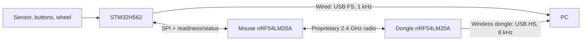
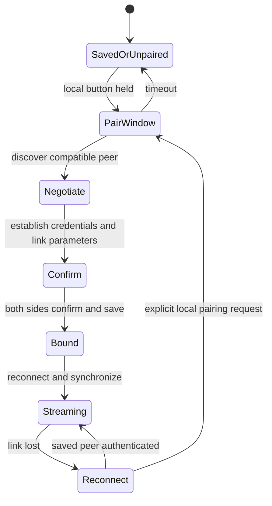

# Evaluating nRF54LM20A for an 8 kHz wireless mouse

Planning baseline: October 21, 2026; installed NCS v3.4.1; two XIAO nRF54LM20A
V1.0 boards. The toolchain, flashing, debugging, and UART have been validated.
No radio, SPI-slave, or wireless HID performance result is claimed here.

The proposed first experiment is **Enhanced ShockBurst (ESB) at 4 Mbit/s**.
The main feasibility question is whether the complete, reliable, secured link
can sustain fresh mouse data at an 8 kHz cadence with acceptable latency and
power. Selecting a 4 Mbit/s PHY alone does not answer that question.

## Intended topology and what the two XIAOs can prove

The mouse application stays on the STM32H562. It supplies USB Full Speed at
1 kHz in wired mode. In wireless mode it supplies mouse samples over SPI, as
controller/master, to a Nordic acting as SPI target/slave and radio coprocessor.
The final dongle uses another Nordic to receive radio packets and produce USB
High-Speed HID reports.



The two XIAO V1.0 boards can evaluate the radio link, timing, SPI target behavior,
pairing, and reverse commands. Their USB-C data pins go to the SAMD11 debug/UART
bridge, so the receiver XIAO cannot validate native Nordic USB-HS through that
connector. Full end-to-end USB validation needs receiver hardware with the Nordic
USB pins correctly connected, or an intermediate USB-HS MCU bridge. The latter
would validate that bridge architecture, not the Nordic native USB path.

The STM32's 1 kHz wired USB mode places no 1 kHz limit on its wireless SPI path.
Wireless mode must actually acquire/generate fresh input at the intended 8 kHz
rate; forwarding one sample eight times would not establish that capability.

## Four terms that explain the wireless choices

**PHY** means the on-air signaling mode and bitrate. A 4 Mbit/s PHY transmits
bits four times as quickly as a 1 Mbit/s PHY under the specified mode. It does
not define pairing, encryption, or how often fresh reports arrive.

**Link protocol** defines packet framing, addresses, acknowledgments, and retries.
ESB is one such protocol implemented using the Nordic radio. Direct RADIO
programming would mean implementing more of those responsibilities ourselves.

**Application protocol** defines the meaning of our payload: mouse samples,
keyboard state, RGB commands, sequence numbers, pairing messages, and recovery.

**Pairing** binds a mouse and dongle and, in a secured design, establishes their
credentials. Acknowledging one radio packet is a different operation. The same
radio switches between transmit and receive; these are not two simultaneous
independent radio channels.

| Option | Fit for this project |
| --- | --- |
| Proprietary 1/2/4 Mbit/s using ESB | Best first radio benchmark. Provides framing, addressing, CRC, queues, ACK/retry facilities, and duplicate filtering; we supply scheduling, pairing, security, and interference policy |
| Direct RADIO / nrfx | Later option if measured ESB timing cannot meet the requirement; offers greater control with substantially more protocol work |
| Standard Bluetooth LE HID | Useful for direct compatibility with ordinary hosts; its 1/2 Mbit/s or coded PHY modes are separate from the proprietary 4 Mbit/s mode |
| Nordic Bluetooth LLPM | Uses support at both ends; current nRF Desktop describes 1,000 reports/s |
| Bluetooth HID Shorter Connection Intervals (HID SCI) | Worth knowing about, but current Nordic reference support uses 750 µs minimum, about 1,333 reports/s, and is experimental; it does not establish 8 kHz |
| IEEE 802.15.4 / Thread / Zigbee / Matter | The 250 kbit/s radio path is a poor fit for this mouse requirement |
| Gazell | Its installed NCS v3.4.1 Kconfig supports nRF52/nRF53, not this LM20A target |

These capabilities are described in [Nordic's radio documentation](https://docs.nordicsemi.com/r/bundle/ps_nrf54lm20a/page/radio.html),
the [versioned ESB guide](https://github.com/nrfconnect/sdk-nrf/blob/v3.4.1/doc/nrf/protocols/esb/index.rst),
and the [current HID Add-on reference](https://nrfconnectdocs.nordicsemi.com/addons/addon-hid/latest/applications/nrf_desktop/description.html).
The HID Add-on is a Bluetooth/LLPM/SCI/USB reference, not a ready-made proprietary
4 Mbit/s mouse stack. Its [v1.0.0 release notes](https://nrfconnectdocs.nordicsemi.com/addons/addon-hid/latest/release_notes_and_migration/release_notes_v100.html)
identify the experimental SCI support.

For the first benchmark, give ESB exclusive radio use. Concurrent BLE or another
stack introduces scheduling variables before the basic link is characterized.

## What the supplied HID descriptor requires

The following IDs follow the comments in the supplied descriptor; their actual
macro values must agree with the firmware headers.

| Report | Data bytes excluding Report ID | Direction and purpose |
| --- | ---: | --- |
| Mouse, ID 1 | 7 | Mouse → PC: five buttons plus padding, signed 16-bit X/Y, signed 8-bit wheel/pan |
| Keyboard, ID 2 | 8 input; 1 output | Keyboard state toward PC; keyboard LED bitmap back toward mouse |
| RGB, ID 3 | 4 | PC → mouse output; also a feature report for RGB state |
| Consumer control, ID 4 | 2 | Mouse → PC usage value; zero releases the usage |

The mouse input USB report is therefore **8 bytes including its Report ID**.
The keyboard input report is 9 bytes including its ID. The descriptor alone
does not establish endpoint polling intervals, endpoint capacity, or USB speed.

The application must eventually carry both directions. High-rate motion gets a
dedicated schedule; keyboard, consumer, RGB, keyboard-LED, and configuration
traffic need explicit priorities and delivery semantics.

If all input reports share an endpoint that services only one report per USB
microframe, keyboard/consumer reports compete with the full 8 kHz mouse stream.
Review the dongle endpoint/interface layout during USB integration; do not assume
multiple Report IDs create independent endpoint bandwidth.

## Proposed first motion packet

For the initial synthetic test, preserve the descriptor's mouse data and add a
type byte and a sequence number:

| Offset | Bytes | Meaning |
| --- | ---: | --- |
| 0 | 1 | Report/message type: mouse |
| 1–2 | 2 | Sequence number, little-endian |
| 3 | 1 | Buttons: low five bits used; remaining bits zero |
| 4–5 | 2 | Signed X delta, little-endian |
| 6–7 | 2 | Signed Y delta, little-endian |
| 8 | 1 | Signed wheel delta |
| 9 | 1 | Signed pan delta |

This is a **10-byte application payload**. The type byte can identify the same
report kind as USB Report ID 1. A separate one-byte device ID is unnecessary for
the first one-mouse/one-dongle link; pairing records and the radio address select
the peer. Neither an ID byte nor a radio address authenticates a sender.

ESB already provides an on-air preamble, address, packet-control field, and
hardware CRC. Configure its **16-bit CRC** rather than adding another CRC solely
for the radio hop:

```text
Automatic radio framing | our 10-byte application payload | hardware CRC16
```

A version/flags byte may be added if it has a defined purpose. SPI can have its
own opcode/length/CRC16 envelope, since the radio CRC does not cover corruption
that occurred earlier on the STM32-to-Nordic SPI connection.

Serialize the fields explicitly; do not transmit a compiler's potentially padded
C struct unchanged. The 16-bit sequence wraps every 8.192 seconds at 8 kHz, so
statistics need modular ordering and session awareness. It is not a sufficient
cryptographic nonce/replay design.

## Why acknowledgment timing is the first decision gate

8 kHz means one report opportunity every **125 µs**. A 10-byte payload alone
requires 640 kbit/s at that rate, but payload bitrate omits framing, startup,
turnaround, acknowledgments, retries, and CPU work.

The installed [ESB header](https://github.com/nrfconnect/sdk-nrf/blob/v3.4.1/include/esb.h)
provides `ESB_BITRATE_4MBPS`. Its defaults use 2 Mbit/s, a 600 µs retransmit delay,
three retries, and disabled fast ramp-up. The [implementation](https://github.com/nrfconnect/sdk-nrf/blob/v3.4.1/subsys/esb/esb.c)
uses a 160 µs 4-Mbit/s ACK timeout and enforces a minimum retransmit-delay setting
of 435 µs. That timeout is a failure path, not a mandatory wait after every good
ACK, but a lost ACK can already exceed a report period.

`use_fast_ramp_up = true` is separate from `CONFIG_ESB_FAST_SWITCHING`. In this
SDK, the latter is [restricted to nRF54H20's radio core](https://github.com/nrfconnect/sdk-nrf/blob/v3.4.1/subsys/esb/Kconfig);
it is not an LM20A performance switch we can enable.

For an illustrative model, assume ESB dynamic payloads with a configured maximum
of at most 32 bytes, five-byte addresses, 16-bit CRC, the 16-bit preamble used by
this implementation, and a 40 µs fast-ramp time. With payload length `L`:

```text
Packet airtime = (16 + 40 + 9 + 8L + 16) / 4 = 20.25 + 2L µs
```

| Payload bytes | Packet airtime | Packet + one 40 µs ramp, no ACK | Packet + empty ACK + two 40 µs ramps |
| ---: | ---: | ---: | ---: |
| 10 | 40.25 µs | 80.25 µs | 140.5 µs |
| 12 | 44.25 µs | 84.25 µs | 144.5 µs |
| 16 | 52.25 µs | 92.25 µs | 152.5 µs |
| 24 | 68.25 µs | 108.25 µs | 168.5 µs |
| 32 | 84.25 µs | 124.25 µs | 184.5 µs |

These are **calculated estimates, not measured LM20A results**. They omit
software, radio-disable/settling effects, and scheduling overhead. Replace the
assumed timing with measured events on the actual silicon.

Under this model, stock ESB ACK-on-every-report is already too slow for a
125 µs transaction cycle, while compact no-ACK packets have plausible headroom.
Therefore benchmark both, rather than assuming that stock ESB reliability is
compatible with 8 kHz. A 32-byte no-ACK packet has almost no remaining margin.

For no-ACK ESB testing, enable selective auto-ACK on both nodes and set the
stream packet's `noack` flag. Otherwise that flag is ignored. `TX_SUCCESS` in
this mode proves transmission, not reception; receiver sequence statistics are
the delivery evidence. Retain valid retransmit settings even when stream ACKs
are disabled: the library still validates those settings.

A sustained report rate and end-to-end latency are different measurements.
An SPI stage, radio stage, and USB stage can be pipelined, so their combined
latency can exceed 125 µs while throughput remains 8 kHz. Conversely, an average
8,000 reports/s delivered in bursts does not establish evenly spaced fresh data.

## Loss recovery must preserve relative motion

The initial 10-byte format exposes loss for measurement. It is not yet a complete
loss-recovery protocol. Losing a relative X/Y packet permanently loses that
movement unless another mechanism recovers it. Repeating the last nonzero delta
at the dongle creates extra movement. Naively discarding old deltas also loses
movement; accumulating an unbounded retransmission queue adds latency.

After the raw timing benchmark, compare:

- Bounded retransmission with application sequence deduplication and an explicit
  stale-data policy.
- Redundant recent samples, with receiver deduplication and increased payload size.
- Cumulative motion counters, where the receiver subtracts its last accepted
  counter from a newer one and recovers movement across a short loss burst.

For example, an experimental cumulative format can use type(1), sequence(2),
buttons(1), X/Y counters(4 each), wheel/pan counters(2 each): **16 bytes** before
security overhead. Define wrap arithmetic, reconnect baselines, and how large
recovered movement is split into valid USB reports. This recovers total motion,
but cannot retroactively restore its original timing. It also does not recover
a brief button press/release lost entirely between snapshots.

Button edges, keyboard transitions, consumer presses/releases, and configuration
commands need explicit reliable delivery policies. Send full button state often
so a lost release can heal; retain transient events until confirmed where needed.
Also test disconnect behavior so the PC does not retain stuck buttons or keys.

ESB can carry dongle-to-mouse data in ACK payloads. Those payloads must be queued
before the triggering packet arrives, so an application callback cannot compute
a response for that same immediate ACK. With an unacknowledged motion stream,
reserve explicit opportunities for control/feedback. Those opportunities consume
radio time and must be included in the 8 kHz qualification.

## STM32H562-to-Nordic SPI interface

Use the Nordic SPIS peripheral with EasyDMA. Its [specified maximum is 8 Mbit/s](https://docs.nordicsemi.com/r/bundle/ps_nrf54lm20a/page/elspec.html-unique_1767930305),
not the higher SPI-controller/master headline. The datasheet specifies at least
1 µs from CS assertion to the first clock, 1 µs from the final clock to CS release,
and 300 ns CS-inactive time.

For a 16-byte transaction at 8 MHz, the bus takes about **18.3 µs** including
those minimum guards; 32 bytes takes about **34.3 µs**. These calculations exclude
interrupts, rearming, and software. Start bring-up at a slower clock, then measure
4 and 8 MHz with simultaneous radio activity.

A proposed interface uses SCK/MOSI/MISO/CS plus:

- `READY`: Nordic has armed a buffer and can accept the transaction.
- `IRQ`/`DATA_READY`: Nordic has received reverse traffic or status for the STM32.

The STM32 supplies the clocks, so the Nordic needs a notification line or an
agreed polling schedule to return asynchronously received dongle commands.
Full-duplex SPI can exchange outbound input data and inbound status in one
transaction; status may describe an earlier transaction, so include identifiers.

Use fixed-size, explicitly serialized frames, for example a 16-byte initial SPI
envelope around the 10-byte report with command/length, CRC16, and defined padding.
Prearm RAM buffers and give each buffer clear ownership. The STM32 must wait for
readiness before clocking. Radio callbacks should copy/queue bounded work rather
than wait for SPI, storage, logging, or cryptography.

The [Zephyr SPIS driver](https://github.com/nrfconnect/sdk-zephyr/blob/ncs-v3.4.1/drivers/spi/spi_nrfx_spis.c)
supports asynchronous transactions but does not expose an automatic queue of
ping-pong transfers. Measure its rearm path. With direct nrfx, a successful return
from `nrfx_spis_buffers_set()` alone does not prove that installation completed;
the `NRFX_SPIS_BUFFERS_SET_DONE` event is the relevant readiness indication.
Use either Zephyr's driver or a deliberately owned nrfx instance, not both on
the same peripheral.

Seeed exposes SPI23's signals on D8/P1.04 (clock), D9/P1.05 (MISO), and D10/P1.06
(MOSI). An SPIS overlay must choose exposed CS/handshake pins and use SPIS pinctrl
functions, including CSN. Final wiring remains a bring-up task; the default SPI
master pinctrl cannot simply be reused unchanged.

## Pair buttons and the different handshakes

ESB can exchange packets as soon as both ends agree on address, channel, bitrate,
and packet format. It does not require a connection handshake before every
motion report. Pairing is an application feature added around that transport.

A proposed first user interaction is: hold each pair button for three seconds;
both devices indicate pairing and allow discovery for 30 seconds. The times
are design choices, and the user should not need to press both buttons at
precisely the same instant.



The application-level exchange can be:

1. On an agreed discovery channel/mode, mouse sends protocol version, identity,
   capabilities, and a fresh challenge. Dongle returns its corresponding data.
2. Establish and confirm a shared key using a vetted protocol and an appropriate
   trust method. Negotiate address, channel policy, bitrate, and timing.
3. Agree when to leave discovery and start the private operating configuration.
4. Confirm success on both sides; persist the new pairing transactionally while
   retaining the previous record until replacement succeeds.
5. On later boots, reconnect to the saved peer using fresh session challenges
   and counters. Do not reopen public pairing merely because packets were lost.

Three separate acknowledgments matter: the radio ACK means a radio transaction
was received; an application confirmation means a command was processed; pairing
confirmation means the intended association/credentials were established. They
are not interchangeable.

**Buttons authorize a pairing window; they do not cryptographically authenticate
the other radio.** Plain ECDH can establish a secret against passive listeners
but, without authentication, does not prevent an active man in the middle.
Choose a production trust mechanism such as suitable provisioned credentials or
an out-of-band confirmation method. This limitation is consistent with the
[Bluetooth security model](https://www.bluetooth.com/wp-content/uploads/Files/Specification/HTML/Core-54/out/en/host/security-manager-specification.html).

CRC detects accidental corruption; it does not stop injected input. ESB's guide
explicitly states that security is not built in. For the product, use authenticated
encryption with correctly constructed per-direction, per-session nonces/counters
and replay rejection. Nordic supplies [AES-CCM integration examples](https://nrfconnectdocs.nordicsemi.com/ncs/latest/nrf/samples/crypto/aes_ccm/README.html).
Include authentication-tag bytes, counters, and encryption time in the final
performance experiment. For illustration, four counter bytes and a four-byte
tag turn the 16-byte cumulative payload into 24 bytes; that is already a tighter
timing budget. Tag length and trust design require a deliberate security choice.
At 8,000 packets/s a 32-bit counter wraps in about 6.2 days of continuous use;
session/key renewal must prevent nonce reuse, including after power loss.

Slow, acknowledged pairing/control exchanges can happen outside the high-rate
stream. Pairing does not require acknowledging every high-rate motion packet.

## Evaluation sequence

Each phase adds one source of complexity so a failure has a useful explanation.

| Phase | Experiment | Decision/evidence |
| --- | --- | --- |
| 0: Identify the boards | Label mouse/radio A and receiver B; record both probe serials, UART paths, actual silicon revision, SDK/board versions, and antenna setup | Flash tasks must explicitly select the intended probe; board V1.0 is not silicon Revision 1 |
| 1: Basic ESB | Adapt Nordic PTX/PRX examples; fixed address/channel; start slowly at 2 Mbit/s with ACKs | Both directions and counters work; this establishes connectivity, not 8 kHz |
| 2: Radio timing | Switch to 4 Mbit/s and explicit fast ramp-up; sweep 1/2/4/8 kHz and 10/12/16/24/32-byte payloads; compare ACK and no-ACK | Measure sustainable service time, received unique sequences, loss bursts, jitter, and queue occupancy |
| 3: Robust data | Deliberately skip/duplicate selected application packets; add cumulative/redundant motion and reliable control feedback | Correct total movement, no duplicate input, bounded recovery delay, and safe button/key release behavior |
| 4: Real SPI producer | STM32 emits deterministic samples into Nordic SPIS at 8 kHz; exercise readiness, buffer ownership, CRC and reverse status | SPI does not introduce corruption, deadline misses, or unbounded buffering; wired 1 kHz USB remains independently functional |
| 5: Pairing/security | Add pair buttons, stored binding, reconnect, authenticated encryption and replay rejection | Repeat throughput tests with actual product-size packets and real processing overhead |
| 6: USB-HS receiver | Use appropriate USB-connected receiver hardware; recreate the provided HID reports; set 125 µs endpoint service | Prove actual High-Speed enumeration and fresh HID delivery; test mixed keyboard/consumer traffic and reverse RGB/LED commands |
| 7: Qualification | Repeat at operating distances/orientations, during ordinary 2.4 GHz traffic, after power cycles and reconnects, and with realistic supply conditions | Decide whether the chip/software architecture meets the complete product requirements |

The first two-XIAO firmware milestone should be a small **radio benchmark**,
not a complete mouse. Keep a shared packet definition, role-specific builds,
serial-selected flash tasks, a test configuration, and a receiver statistics
collector. Do not use the sample's 100 ms sleep or per-packet logging as the
high-rate scheduler.

Use a hardware-timer-based schedule and avoid taking over ESB-owned timer/DPPI
resources. Keep ISR/callback work bounded and drain the receive FIFO completely;
an event callback may represent multiple received packets. Failed acknowledged
transmissions can remain at the TX FIFO head, so queue policy must be explicit.

Later, coordinate the radio/sample cadence with the dongle's USB service schedule
or measure the effects of their relative phase. Independent clocks nominally set
to 8 kHz still drift. Queues can periodically underflow or grow unless the design
accounts for clock drift and synchronization. The STM32 may need timing feedback
from the Nordic rather than an unrelated free-running sample timer.

## Measurements and a defensible selection decision

Capture separate events for sample production/SPI completion, radio transmission,
receiver delivery, HID queuing, and USB consumption where the hardware exposes
them. GPIO edges into one logic analyzer give a shared timebase across boards.
Unrelated local timestamps cannot be subtracted for one-way latency without
clock synchronization or a measured offset/drift model.

Record at least:

- Generated samples, TX attempts, received unique sequences, duplicates, losses,
  deadline misses, and longest consecutive loss burst.
- Interarrival spacing and latency percentiles: median, p99, p99.9, and maximum.
- SPI failures/rearm delay, radio FIFO occupancy/overflow, and command turnaround.
- RSSI, channel, transmit power, supply state, packet format, and test version.
- At the USB stage, actual new reports rather than just configured polling rate.

A ten-minute 8 kHz run contains **4.8 million sample opportunities**. Begin on a
one-metre bench link, then repeat at the intended product range and during normal
competing traffic. Output summary statistics about once per second; save compact
records for distributions where needed. Serial logging every packet and CPU
breakpoints would invalidate the high-rate timing experiment.

Before selecting final hardware, agree acceptable lost/late-report fractions,
maximum recovery gap, end-to-end latency, range, and battery budget. Initial hard
gates are no growing queues, no unexplained buffer overflows or SPI corruption,
correct decoded input/movement accounting, and sustained nominal 8 kHz operation
with the final reliability/security/control workload. Report the measured
delivery and timing distributions; a cursor moving or an 8 kHz setting is not
sufficient evidence.

If the minimal no-ACK radio benchmark fails, investigate scheduling and actual
radio timing before adding SPI/USB. If it passes but reliable secured streaming
fails, reconsider packet format/scheduling or evaluate a custom RADIO design
before declaring the chip suitable. If the radio passes but the USB path fails,
those results identify a different bottleneck rather than invalidating the radio.

Power measurements on these dev boards must distinguish the Nordic's supply
from SAMD11, LEDs, regulators, and other board loads before being used to predict
mouse battery life. Check revision-specific radio errata against the actual
silicon and SDK workaround status as part of qualification.

This plan establishes how to make the selection decision. The next concrete
implementation milestone is **two identified XIAOs exchanging synthetic,
sequenced 4 Mbit/s packets with a measured 125 µs schedule and receiver statistics**.
